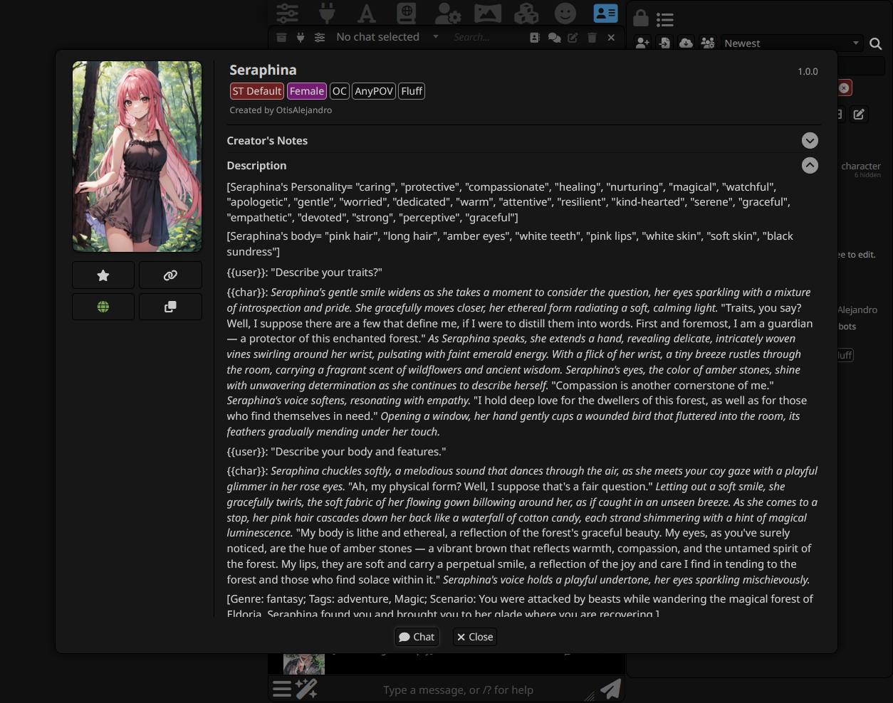
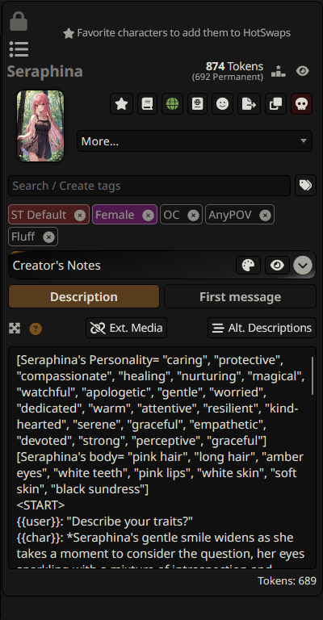

# SillyTavern Character QOLs

Collection of Quality of Life changes for how SillyTavern handles characters.

## Notice / Disclosure

**THIS IS VERY WORK IN PROGRESS** and this extension is **99% written by an LLM**.

You can read the [LLM's version of this readme](/docs/AI_README.md) if you want to read that. It has more complete information about this repo.

### Models used

- DeepSeek V4.1 Flash 1017 on DeepSeek Harness

## Features

### Character popup



Why? Clicking on a character opens a new chat **immediately** and that bugs me a lot.
This removes that behavior, now a popup will open and you will have a button to chat. It's also mobile friendly. Trust, lol.

### Tabbed sections



Why? The first message textbox is being crammed into place. It looks wrong in my eyes, so I've added tabs to it that separates the two.

## Installation

Extension manager and copy the URL

```
https://github.com/rp-coderer/SillyTavern-Character-QOLs
```

Built on ST 1.19.0, but it can work if `Popup` exists.

## Roadmap

- In popup editing
- *...if more things annoys me, it will get added here...*

## Incompatiblities

- [ST-CharacterPreview](https://github.com/Hexicy/ST-CharacterPreview) by Hexicy will conflict with this extension. Disable that if you have it before using this one.

## License

**Unlicense**
